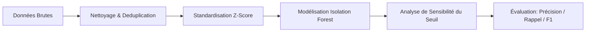

<div align="center">

  

  # 🛡️ Détection de Fraude Bancaire par Machine Learning
  ### *Détection d'anomalies non supervisée sur des transactions bancaires avec R*

  [](https://www.r-project.org/)
  [](https://github.com/david-cortes/isotree)
  [](https://www.kaggle.com/datasets/mlg-ulb/creditcardfraud)
  [](#)

</div>

---

## 🎯 Objectif du Projet

Ce projet s'intéresse à la **détection non supervisée d'anomalies** dans un contexte de transactions par carte bancaire fortement déséquilibrées. L'objectif principal est de repérer efficacement les comportements frauduleux en utilisant l'algorithme **Isolation Forest** sans s'appuyer sur des étiquettes d'apprentissage historiques durant l'étape d'isolement.

---

## 📊 Données & Prétraitement

- **Source :** Jeu de données Kaggle [Credit Card Fraud Detection (ULB)](https://www.kaggle.com/datasets/mlg-ulb/creditcardfraud).
- **Volume initial :** 284 807 transactions bancaires.
- **Déséquilibre :** Seulement **0,17 %** de transactions frauduleuses (ratio de 1 pour 578).

### 🛠️ Nettoyage et Feature Engineering
1. **Déduplication :** Suppression de 1 081 doublons identifiés dans le jeu d'origine.
2. **Normalisation :** Standardisation z-score des variables `Amount` et `Time`.
3. **Analyse Exploratoire (EDA) :** Étude comparative des distributions marginales et des matrices de corrélation entre classes.

> ⚠️ **Note sur le jeu de données local (`creditcard_sample.csv`) :**  
> Le fichier complet (143 Mo) étant volumineux pour GitHub, un échantillon de démonstration de **4 992 transactions (dont 492 fraudes, soit ~10%)** est mis à disposition. Les métriques obtenues sur cet échantillon varient donc de celles publiées dans le rapport global. Pour exécuter le code complet, téléchargez le fichier source et adaptez le chemin d'accès dans le script.

---

## 🔬 Méthodologie



1. **Modélisation :** Construction du modèle d'isolation au moyen du package R `isotree`.
2. **Calibrage du seuil :** Analyse de sensibilité afin de régler le seuil d'anomalie et d'optimiser le compromis entre la **Précision**, le **Rappel** et le **F1-Score**.

---

## 📁 Structure du Dépôt

```bash
.
├── script Banking fraud detection.R  # Script R complet (Prétraitement, IF, Évaluation)
├── Banking_Fraud_Detection.pdf       # Rapport d'analyse complet en format PDF
├── creditcard_sample.csv             # Échantillon de démonstration (4 992 obs.)
└── README.md                         # Documentation du projet
```

---

## 🛠️ Outils & Bibliothèques R

- **R Base & Tidyverse :** Manipulation de données et visualisations.
- **`isotree` :** Implémentation haute performance de l'algorithme *Isolation Forest*.
- **`caret` / `PRROC` :** Calcul des métriques et courbes d'évaluation.

---

## 👩‍💻 Auteure

**Amina Mir** ([@amina-mir](https://github.com/amina-mir))  
*Master Économie Appliquée et Data Science*  
FSJES Meknès — Université Moulay Ismail

---

<div align="center">
  <i>Si ce projet vous a été utile, n'hésitez pas à lui accorder une ⭐️ sur GitHub !</i>
</div>