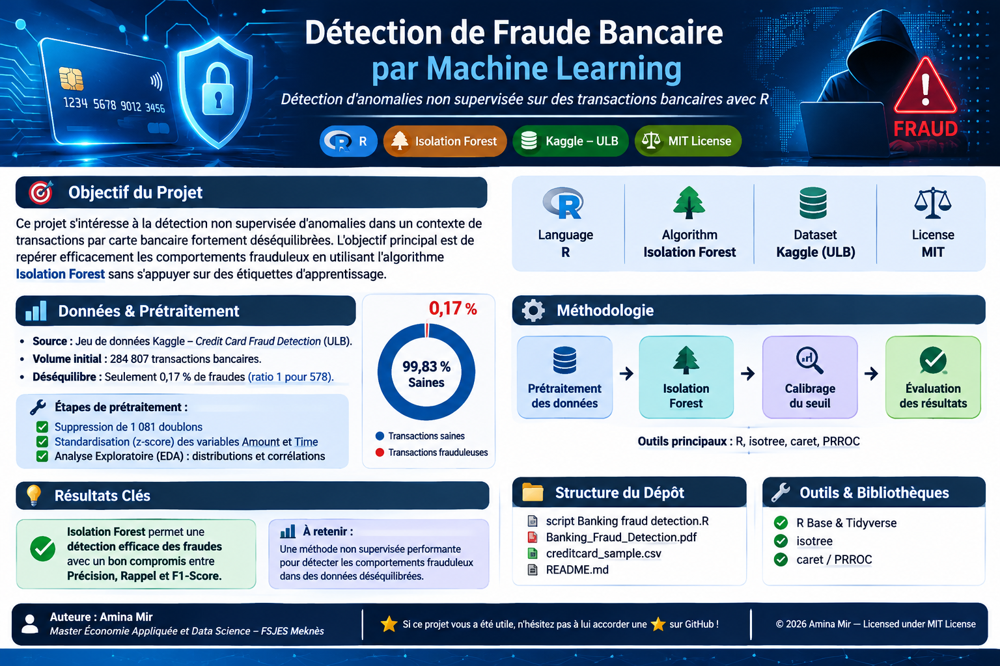
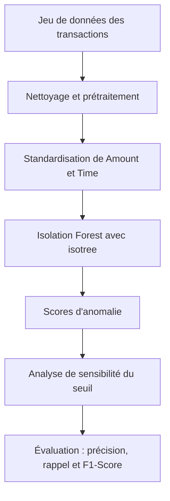

 
<p align="center">
  
</p>

<h1 align="center">🛡️ Détection de Fraude Bancaire par Machine Learning</h1>

<p align="center">
  <strong>Détection d'anomalies non supervisée sur des transactions bancaires avec R</strong>
</p>

<p align="center">
  
  
  
  
</p>

---

## 🎯 1. Objectif du projet

Ce projet porte sur la **détection non supervisée d'anomalies** dans des transactions par carte bancaire, dans un contexte où les classes sont fortement déséquilibrées.

L'objectif est d'identifier les comportements potentiellement frauduleux à l'aide de l'algorithme **Isolation Forest**, implémenté en R avec le package `isotree`.

L'étape d'isolation est réalisée sans utiliser les étiquettes historiques des transactions comme variables d'apprentissage.

## 📊 2. Données et prétraitement

**Source :** [Credit Card Fraud Detection — Kaggle / ULB](https://www.kaggle.com/datasets/mlg-ulb/creditcardfraud)

| Indicateur | Valeur |
|---|---:|
| Transactions initiales | 284 807 |
| Part des fraudes | 0,17 % |
| Ratio approximatif | 1 fraude pour 578 transactions |
| Doublons supprimés | 1 081 |

### Étapes de préparation

1. **Déduplication :** suppression des 1 081 doublons identifiés.
2. **Standardisation :** transformation z-score des variables `Amount` et `Time`.
3. **Analyse exploratoire (EDA) :** comparaison des distributions et étude des corrélations entre les variables et les classes.

> **Note sur le fichier `creditcard_sample.csv`**
>
> Le jeu de données complet (environ 143 Mo) n'est pas inclus dans le dépôt. Un échantillon de démonstration de **4 992 transactions, dont 492 fraudes (environ 10 %)** est fourni.
>
> Sa proportion de fraudes étant différente de celle du jeu initial, les résultats obtenus sur cet échantillon ne sont pas directement comparables à ceux du rapport réalisé sur les données complètes.
>
> Pour reproduire l'analyse complète, téléchargez le jeu original depuis Kaggle et adaptez le chemin d'accès dans le script R.

## 🔬 3. Méthodologie

Le processus suit les étapes suivantes :



### Modélisation avec Isolation Forest

L'algorithme **Isolation Forest** détecte les observations atypiques en construisant des arbres d'isolation.

Les anomalies, plus faciles à isoler, obtiennent des scores permettant de les distinguer des transactions habituelles.

Le modèle est implémenté avec le package R [`isotree`](https://github.com/david-cortes/isotree).

### Calibrage du seuil et évaluation

Une analyse de sensibilité est menée sur le seuil de détection afin d'étudier le compromis entre :

- **Précision :** part des transactions signalées comme frauduleuses qui sont réellement frauduleuses.
- **Rappel :** part des fraudes effectivement détectées.
- **F1-Score :** mesure synthétique combinant précision et rappel.

L'approche d'isolation reste non supervisée ; les étiquettes disponibles servent à l'analyse comparative et à l'évaluation des seuils, et non à l'étape d'apprentissage de l'isolation.

## 📈 4. Points clés

- Le jeu initial présente un **déséquilibre marqué**, avec seulement 0,17 % de transactions frauduleuses.
- La préparation comprend la suppression de 1 081 doublons et la standardisation de `Amount` et `Time`.
- Isolation Forest est utilisé pour produire des scores d'anomalie sans apprentissage supervisé des étiquettes.
- Le seuil de décision est étudié à travers le compromis entre précision, rappel et F1-Score.

*Les valeurs numériques détaillées des métriques ne sont pas reprises ici ; consultez le rapport PDF pour les résultats détaillés.*

## 📁 5. Structure du dépôt

```text
Banking_Fraud_Detection/
│
├── header_banner.png
├── script Banking fraud detection.R
├── Banking_Fraud_Detection.pdf
├── creditcard_sample.csv
└── README.md
```

| Fichier | Description |
|---|---|
| `script Banking fraud detection.R` | Script R : prétraitement, Isolation Forest et évaluation |
| `Banking_Fraud_Detection.pdf` | Rapport complet de l'analyse |
| `creditcard_sample.csv` | Échantillon de démonstration de 4 992 transactions |
| `header_banner.png` | Bannière graphique du projet |
| `README.md` | Documentation du dépôt |

## 🛠️ 6. Outils et bibliothèques R

| Outil / Package | Utilisation |
|---|---|
| R | Environnement de programmation et d'analyse |
| tidyverse | Manipulation et visualisation des données |
| isotree | Implémentation d'Isolation Forest |
| caret | Outils d'évaluation des modèles |
| PRROC | Analyse des performances et courbes de précision-rappel / ROC |

## ⚙️ 7. Reproduire l'analyse

### Prérequis

- R installé sur votre machine.
- Le dépôt cloné localement.
- Le fichier `creditcard_sample.csv` présent dans le répertoire du projet, ou le jeu complet téléchargé depuis Kaggle.

### Installation des packages

```r
install.packages(c(
  "tidyverse",
  "isotree",
  "caret",
  "PRROC"
))
```

### Exécution

Ouvrez le script `script Banking fraud detection.R` dans RStudio.

Vérifiez que le chemin du fichier CSV correspond à son emplacement sur votre machine, puis exécutez le script.

## 👩‍💻 8. Auteure

**Amina Mir** — [@amina-mir](https://github.com/amina-mir)

*Master Économie Appliquée et Data Science*  
FSJES Meknès — Université Moulay Ismail, Maroc

<p align="center">
  <em>Machine Learning · Anomaly Detection · R · Data Science</em>
</p>

---

<p align="center">
  ⭐ Si ce projet vous a été utile, n'hésitez pas à lui attribuer une étoile sur GitHub !
</p>
